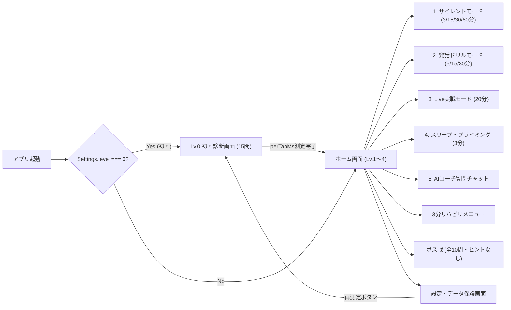

# Project Rewire 機能仕様書（v1.0）

## 1. 画面一覧と画面遷移

---

## 2. 各画面の詳細機能仕様

### 2-1. ホーム画面（`HomePage.tsx`）
* **ヘッダー（`Header.tsx`）**
  * 現在のレベル（Lv.0〜Lv.4）およびLv.1のフェーズ（前半：絵カード期／後半：語順ブロック期）を表示する。
  * **連続記録**：本文色（墨色 `#1C1917` またはダーク文字色 `#E7E5E4`）の数字と単色の `Flame` アイコンで表示する（クリムゾンは使用しない）。
  * **お休みチケット残数**：`0〜2` 枚を表示する（毎週月曜午前4時に最大2枚まで自動補充、未学習日があれば自動で1枚消費して連続記録を維持）。
  * **テーマ切替ボタン**：`auto`（OS追従）／`light`／`dark` をワンタップで巡回切り替えする。
* **JSONバックアップ促進バナー（`BackupBanner.tsx`）**
  * 最終バックアップから7日以上経過時、またはレベル昇格直後にホーム上部に表示する。
  * 最終バックアップから14日以上経過している場合は閉じるボタン（`×`）を非表示にし、バックアップを実行するまで閉じられない仕様とする（アプリの全学習機能はそのまま利用可能）。
* **親指1タップ開始「迷ったらこれ」ボタン**
  * `selectRecommendedAction()` により、以下の優先順位でプログラム的に最適モードを自動選出する：
    1. 最終学習日から2日以上空いている場合：**3分リハビリメニュー**
    2. 夜間（22時〜翌3時）かつ当日学習済みの場合：**スリープ・プライミング（3分）**
    3. 当日サイレントモード実施済みかつ発話ドリル未実施の場合：**発話ドリル（5分）**
    4. 上記以外：**サイレントモード（15分）**（期限到来のSRS復習件数を併記）
* **昇格ゲート進捗カード（`PromotionProgress.tsx`）**
  * ①コアセット達成率（語順ブロック形式のみ集計）、②リスニング直近40問正答率、③発話直近40回緑達成率、および予測ETAを表示する。
  * ①〜③がすべて基準以上になると「④ ボス戦に挑戦」ボタンが有効化される（ボス戦不合格時は24時間クールダウン残り時間を表示）。
* **ヒートマップカレンダー（`HeatmapCalendar.tsx`）**
  * 直近28日間の学習時間を緑1色の濃淡（0分、1〜9分、10〜24分、25〜44分、45分以上）で表示する。
  * 日付セルをタップすると、その日のモード別学習時間内訳と、4人のAI社員レポート・Live実戦総評を表示する。

### 2-2. Lv.0 初回レベル診断画面（`DiagnosisPage.tsx`）
* 初回起動時（`level === 0`）または設定画面の「再測定する」ボタンから起動する。
* 全15問（前半5問：音変化リスニング4択、後半10問：語順ブロックタップ）を出題する。
* ユーザーのタップ間隔（ms）を記録し、その中央値を `350〜700ms` にクランプして `Settings.perTapMs` に保存し、`level` を `1` に更新する。

### 2-3. サイレントモード画面（`SilentModePage.tsx`）
* 時間枠：`3分` / `15分` / `30分` / `60分`（および `3分リハビリ`）。
* 15問を1バッチ（SRS期限到来復習10問＋新規・弱点5問）として編成する。
* **音声再生中**：選択肢をマスクして非表示にし、タイマーも停止する。再生完了（`onend` またはタイムアウト）の瞬間に選択肢を表示し、`0ms` から計測を開始する。
* **Lv.1前半（絵カード期）**：状況ビジュアルカード4枚を表示し、聴こえた英文に合致する場面を1枚選ばせる。直近30問で正答率85%以上かつ緑60%以上を達成すると、自動的にLv.1後半（語順ブロック期）へ移行する。
* **Lv.1後半以降（語順ブロック期）**：厳密シャッフルされた語順ブロック（3〜9個）をタップ（またはPCの `1〜9` キー）で並べる。移動したブロックの元の位置には同サイズの半透明プレースホルダーを残し、周囲のボタンを1pxもずらさない。
* **その日の2回目以降**：今日学んだ問題の定着復習と、Lv.2以降は連続多聴リスニング（`listening_long`）を織り交ぜる。
* **回答後カード（`PostAnswerCard.tsx`）**：色（緑・黄・赤）と初動・完了秒数、英文全体、**「このセリフで言っていること（場面の意図）」**、**「英語の語順のまま前から理解（チャンク分解・コアイメージ）」**、および発音フォームを表示する。「不自然な問題として報告」ボタンを押すと `disabled = true` となり以後出題されない。
* **問題バンク＆4人のAI社員ステータスパネル（`HomePage.tsx`）**：現在の有効問題数（初期コア問題／AI生成問題／Live弱点・応用）の内訳を表示し、ワンタップで「今すぐAI社員に新問題を5問作らせる」手動生成ボタンを提供する。また各問題カード（`VisualCard.tsx`）の右上に出題元バッジ（`コア問題` / `AI生成` / `Live弱点` / `弱点応用`）を表示する。
* **終了処理**：指定時間を過ぎたら解いている問題を最後まで解いてから終了し、即時スコア（スコア・緑の割合・最大コンボ・ゲート進捗）を表示すると同時に、裏側で `AiReport(status:'pending')` を登録して4人のAI社員パイプラインを非同期実行し、Cloudflare D1へ自動同期する。

### 2-4. 発話ドリルモード画面（`SpeakModePage.tsx`）
* 時間枠：`5分` / `15分` / `30分`。
* 今週サイレントモードでクリア（緑または黄）した表現を優先出題する（サイレント→発話ブリッジ）。
* **オウム返し禁止**：お手本の英語音声は一切流さない。発話のきっかけは「状況ビジュアルカード」「発話ミッション（この場面で伝えたいこと＋最初の1語ヒント表示ボタン）」「相手の短い問いかけ音声（`promptAudioText`）」のみ。
* **Lv.3 パラフレーズ**：使用禁止の `ngWords` を明示し、別の表現での言い換えを求める。
* **押して話すマイクボタン（Push-to-Talk ／ タップ切替両対応）＋自己判定3ボタン**：
  * `SpeechRecognition` / `webkitSpeechRecognition` が利用可能な環境では、マイクボタンを押している間（またはタップで録音開始→再タップで停止）音声認識を起動し、認識結果と単語一致率（80%以上で一致）を補助表示する。
  * 最終評価はユーザーの自己判定ボタン（「2秒以内に言えた（緑）」「遅れた（黄）」「言えなかった（赤）」）で決定する。STTが不一致でも自己判定で上書きでき、STTの結果だけでSRSを赤にすることはしない。

### 2-5. Live実戦モード画面（`LiveModePage.tsx`）
* 現在のLv、昇格ゲートの未達項目、直近の弱点チャンク、日常85%／Miami Heat 15%の比率を組み込んだ開始用プロンプト（終了時の「Finish」JSON出力指示付き）を自動生成し、ワンタップでコピーできる。
* セッション終了後、出力されたテキストを貼り付けると、前後の雑談やコードフェンスを除去して最初の対応する `{...}` を抽出し、zodで検証する。
* `durationMinutes` が `5〜60` の範囲内ならその分数、範囲外なら `20分` をカレンダーに加算する。
* `weakChunks`（最大5件、40文字以内、英字・空白・基本記号のみ）を `source: 'live'` として登録し、**3語以上**は語順ブロック問題、**3語未満**は発話ドリル専用（`speakOnly: true`）としてSRS最優先キューに入れる。

### 2-6. スリープ・プライミングモード画面（`SleepModePage.tsx`）
* 起動すると自動的に**スリープテーマ**（背景 `#140F0A`、カード `#1C150E`、枠線 `#2A2016`、本文 `#D97706`）に切り替わる。
* その日苦戦した3チャンクを、英文を表示せず音声だけで連続再生する。
* 最後に1回「頭の中で言えたか」を自己判定させ、学習時間（3分）と試行ログのみを記録する（**SRSの段階や期限には一切反映しない**）。

### 2-7. ボス戦画面（`BossBattlePage.tsx`）
* 全10問、ヒントなし（Lv.1は音変化リスニング4問＋語順・発話6問、Lv.2以降も同等の比率）。
* 黄以内で正解した問題だけを正解として数え、**8問以上で合格**。
* 合格時：次のレベルへ昇格し、Lv.2〜4のコアセット40チャンクを確定・固定する。
* 不合格時：`bossCooldownUntil` に24時間後のタイムスタンプを設定し、間違えた問題（赤）をSRSの段階0（最優先復習キュー）へ戻す。

### 2-8. AIコーチ質問チャット画面（`CoachChatPage.tsx`）
* 質問に対して直訳を一切使わず、「空間・動き・感情のコアイメージ」と「英語の例文」だけで回答する。
* Lv.2以降は *"What does 〜 mean in a core image?"* 等の英語質問テンプレートボタンを表示する。
* オフライン時は質問を `status: 'pending_offline'` としてIndexedDBに保存し、次回オンライン時にワンタップで再送できる確認バーを表示する。
