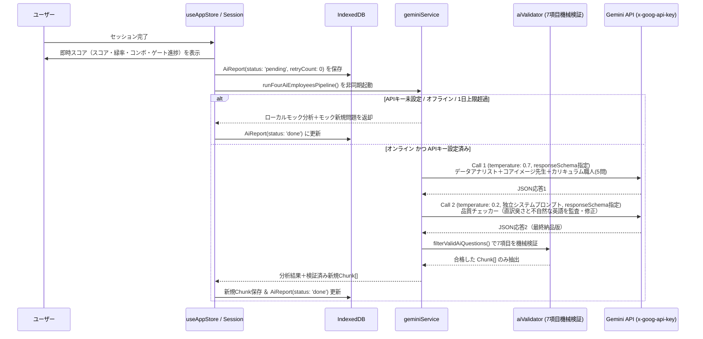

# Project Rewire 詳細設計書（v1.0）

## 1. ディレクトリ構成と責務分離

```text
project-rewire/
├── docs/                  # 設計・仕様ドキュメント一式（01〜04）
├── public/                # PWAアイコン（icon-192.svg, icon-512.svg）
├── src/
│   ├── domain/            # 純粋関数・ビジネスロジック（React・ブラウザAPI依存ゼロ）
│   │   ├── aiValidator.ts     # AI出力の7項目機械検証、直近20件の重複禁止リスト
│   │   ├── contrast.ts        # カラートークン定義、WCAG AA（4.5:1以上）相対輝度・コントラスト比計算
│   │   ├── liveParser.ts      # Live実戦ログ抽出（コードフェンス/波括弧バランス解析・zod検証・3語境界振り分け）
│   │   ├── promotionGate.ts   # Lv.1前半→後半移行判定、昇格ゲート①〜③集計、Lv.2〜4コア40問固定、ETA・ボス戦判定
│   │   ├── scheduler.ts       # 15問バッチ編成、同一grammarPattern/sceneCategory連続禁止、Heat比率15%±5%制御、recomposed生成
│   │   ├── shuffle.ts         # acceptableOrdersのどれとも一致しない厳密シャッフル（重複単語のBlock ID維持）
│   │   ├── srs.ts             # SRS段階遷移（[1,3,7,14,30]日、卒業、90日後抜き打ち、赤によるリセット）
│   │   ├── sttMatcher.ts      # STT単語一致率（小文字化・句読点除去・80%閾値）、自己判定優先解決、NGワード検出
│   │   ├── studyDate.ts       # 午前4時区切りの学習日算出、毎週月曜4時のお休みチケット補充・自動消費、リハビリ提案判定
│   │   └── timingJudge.ts     # perTapMs中央値・クランプ（350〜700ms）、completionBudget計算、リプレイ前後評価キャップ
│   ├── data/
│   │   └── seed/          # 差し替え可能な初期同梱データ（lv0_diagnosis.json, lv1_core.json, lv2〜4_sample.json）
│   ├── db/                # IndexedDB操作、マイグレーション、防御的バックアップ/インポート検証
│   │   ├── backup.ts          # APIキー除外エクスポート、10MB上限・プロトタイプ汚染再帰検査・zod検証・比較プレビュー付きインポート
│   │   ├── database.ts        # idbストア定義、永続化要求、1問ごとのアトミックトランザクション保存
│   │   └── migration.ts       # schemaVersion検査および旧バージョンからのマイグレーション変換
│   ├── services/          # 外部API・ブラウザAPI連携
│   │   ├── audioService.ts    # Web Audio APIによるクリック音合成、navigator.vibrate?.(20)、Lv.3環境ノイズ生成
│   │   ├── geminiService.ts   # 4人のAI社員（Call 1: temp 0.7 → 機械検証 → Call 2: temp 0.2）、429指数バックオフ、ローカルモック代替
│   │   ├── logger.ts          # APIキー・トークンの自動マスク付きセキュアロガー
│   │   ├── sttService.ts      # SpeechRecognition制御（1.5s/1.0s無音区切り、非対応・オフライン時の自動フォールバック）
│   │   └── ttsService.ts      # speechSynthesis制御（タップ時アンロック、直前cancel()、onendタイムアウト保護、複数話者・ピッチ変化）
│   ├── components/        # 再利用可能なUIコンポーネント（Header, BackupBanner, VisualCard, WordOrderBoard, PostAnswerCard等）
│   ├── pages/             # 各画面コンポーネント（HomePage, DiagnosisPage, SilentModePage, SpeakModePage, LiveModePage, SleepModePage, BossBattlePage, CoachChatPage, SettingsPage）
│   ├── hooks/             # カスタムフック（useAppStore, useTheme, useKeyboardShortcuts）
│   ├── types/             # 共通型定義（Level, Rating, Chunk, ReviewState, Attempt, Session, AiReport, Settings, IconName等）
│   └── __tests__/         # 単体・結合・UI・セキュリティテストスイート
└── README.md
```

---

## 2. データモデルとIndexedDBスキーマ設計

データベース名：`project-rewire-db`（Version `1`）

| オブジェクトストア | 主キー (`keyPath`) | インデックス | 保存されるデータと主な責務 |
|---|---|---|---|
| `chunks` | `id` | なし | 全問題チャンク（初期シード60問、`source:'ai'`、`source:'recomposed'`、`source:'live'`）。「不自然」報告時は `disabled: true` に更新 |
| `reviewStates` | `chunkId` | なし | 各チャンクのSRS段階（`stage: 0..4`）、次回期限 `dueDate`、`graduated`、`spotCheckDate`、`recentRatings`、`wordOrderRatings` |
| `attempts` | `id` | `by-studyDate`, `by-sessionId`, `by-chunkId` | 1問ごとの回答ログ（初動 `reactionMs`、完了 `completionMs`、リプレイ回数、評価 `rating`、ミス種別 `missType`、STT補助記録） |
| `sessions` | `id` | `by-studyDate` | 学習セッション記録（モード、予定分数、実稼働秒数 `activeSeconds`、学習日 `studyDate`） |
| `aiReports` | `id` | `by-sessionId`, `by-status` | 4人のAI社員の分析結果およびLive実戦総評（`status: 'pending' | 'done' | 'failed'`、`retryCount` 最大3回） |
| `settings` | `id` (`'current'`) | なし | アプリ設定（`schemaVersion`, `level`, `lv1Phase`, `perTapMs`, `geminiApiKey`, `geminiModel`, `dailyApiCallLimit`, `ttsRate`, `clickSound`, `themePreference`, `lastBackupAt`, `restTickets` 等） |
| `coachMessages` | `id` | なし | AIコーチ質問チャットの履歴およびオフライン時の未送信質問キュー（`status: 'pending_offline' | 'answered'`） |

### 2-1. 1問ごとのアトミックトランザクション保存
`saveQuestionProgressTransaction()` は、`db.transaction(['attempts', 'reviewStates', 'sessions'], 'readwrite')` を単一トランザクションで開き、`Attempt` の追加、`ReviewState` の更新、`Session.activeSeconds` の更新を同時にコミットする。途中クラッシュやタブ強制終了時でもデータの不整合が発生しない。

---

## 3. Gemini API 2ステップパイプライン詳細設計



---

## 4. Web Speech API / Web Audio API 制御と iOS Safari 対策
1. **アンロックと詰まり防止**：学習開始ボタンのタップイベントハンドラ内で同期的に `unlockSpeechSynthesis()` と `unlockAudioContext()` を実行する。読み上げの直前には必ず `window.speechSynthesis.cancel()` を呼び出す。
2. **`onend` 未発火保護タイマー**：`calculateTtsTimeoutMs(text, rate)` により `Math.ceil(((text.length / 14) / rate) * 1000 + 1000)` ms のタイマーをセットし、iOS Safari のバグで `onend` が発火しなかった場合でも確実に再生完了コールバックを呼び出して選択肢を表示する。
3. **英語音声の厳選と複数話者対応**：`voiceschanged` を待ってから `en-US` 優先（なければ `en-*`）で英語音声のみを抽出し、日本語音声は除外する。Lv.2以降の複数話者モードでは端末内の英語音声からランダムに選択し、英語音声が1種類しかない端末では `pitch`（`0.88〜1.14`）と `rate`（`±0.03〜0.07`）を微調整して複数話者を擬似再現する。

---

## 5. セキュリティ設計
1. **XSS完全防止**：`dangerouslySetInnerHTML` の使用をコード全体で禁止し、`eslint.config.js` の `no-restricted-properties` / `no-restricted-syntax` ルールで機械的にエラーとする。AIの応答、Liveログ、質問チャットはすべてReactのテキストノードとして描画する。
2. **JSONインポート防御**：
   * バイトサイズが `10MB`（`10 * 1024 * 1024` bytes）を超える文字列はパース前に拒否する。
   * 生JSONテキストの正規表現検査、`JSON.parse` の reviver、およびパース後の `assertNoPrototypePollution()` 再帰走査の3重ガードにより、`__proto__`、`constructor`、`prototype` キーを含むデータを完全に拒否する。
   * `BackupBundleSchema`（zod）による厳格な型検証を通過したデータのみを比較確認ダイアログへ渡す。
3. **APIキー保護**：
   * APIキーは設定画面から入力してIndexedDBの `settings` ストアにのみ保存する（`.env` 等でのビルド時埋め込みは一切行わない）。
   * Gemini API 呼び出し時はURLクエリパラメータ（`?key=`）を使わず、`x-goog-api-key` HTTPヘッダーで送信し、URLログからの漏洩を防ぐ。
   * `exportBackupJson()` では `geminiApiKey` を構造的に除外し、`logger.ts` の `maskSensitiveText()` でエラーメッセージやログ出力からAPIキーを自動マスクする。
